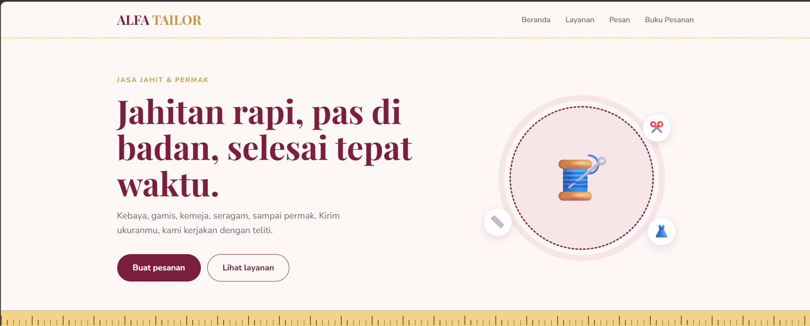
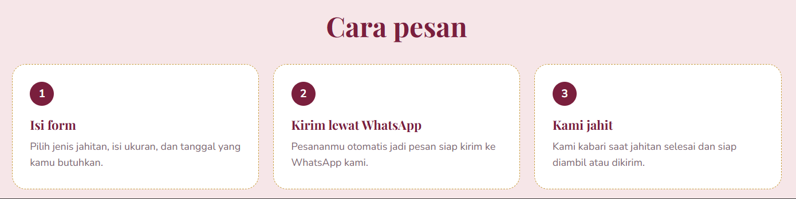
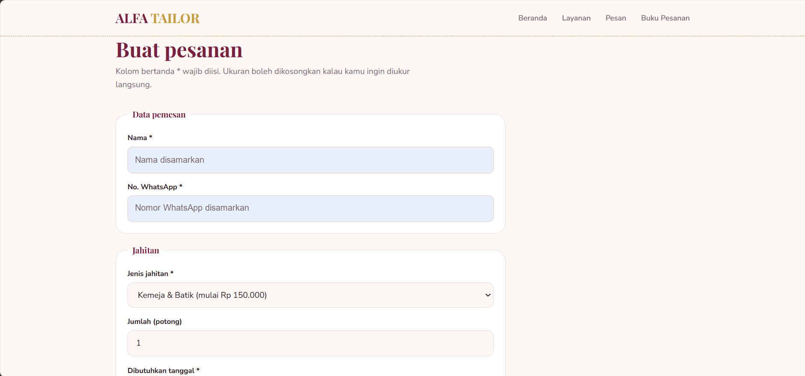
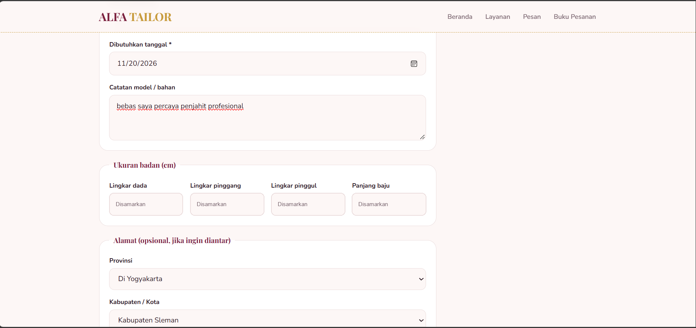
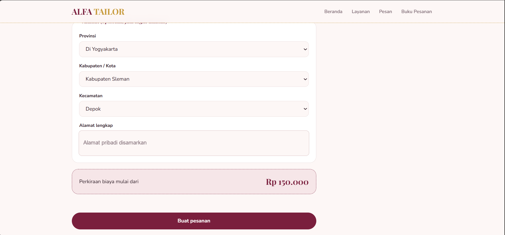
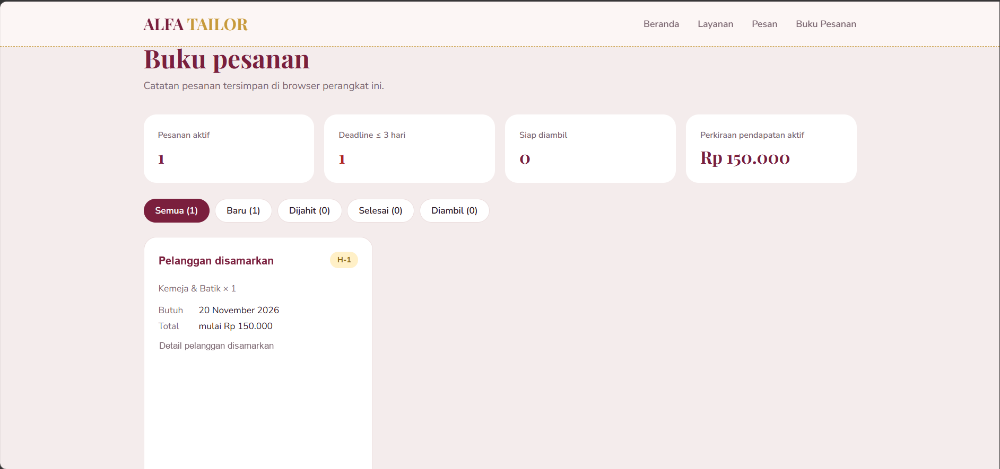

# ALFA TAILOR

Website jasa jahit dengan tiga halaman, formulir pemesanan, dan buku pesanan.

- `index.html`: beranda, daftar layanan, dan cara pesan
- `pesan.html`: formulir pesanan dengan estimasi biaya dan alamat wilayah
- `buku-pesanan.html`: ringkasan, filter status, dan pengelolaan pesanan
- `css/style.css`: tampilan responsif bersama untuk semua halaman
- `js/script.js`: interaksi layanan, form, API wilayah, dan buku pesanan
- API publik: [API Wilayah Indonesia](https://github.com/emsifa/api-wilayah-indonesia), tanpa API key

## Dokumentasi Tampilan

Screenshot berikut memperlihatkan halaman utama, proses pemesanan, data wilayah dari API, dan buku pesanan. Nama, nomor WhatsApp, ukuran badan, dan alamat pribadi pada gambar sudah disamarkan.

### Beranda

### Cara pesan

### Formulir pesanan

### Ukuran badan

### Pilihan wilayah dari API

### Buku pesanan

## Konfigurasi

Buka bagian `KONFIGURASI` di `js/script.js` untuk mengubah:

- `TOKO.nama` dan `TOKO.wa` (nomor WhatsApp format `62xxxxxxxxxx`)
- `LAYANAN`: daftar jenis jahitan dan harga mulai dari

Cara menjalankan: sajikan folder `alfa-tailor` melalui server lokal (misalnya Live Server di VS Code), lalu buka `index.html` dari alamat server tersebut. Gunakan satu alamat server yang sama saat berpindah halaman agar pesanan terbaca di buku pesanan. Internet diperlukan untuk memuat Google Fonts dan data API wilayah. Pesanan tersimpan di `localStorage` browser yang digunakan.

Catatan: `js/wilayah-data.js` menyediakan data cadangan offline untuk provinsi dan kabupaten/kota jika API tidak bisa dihubungi.
